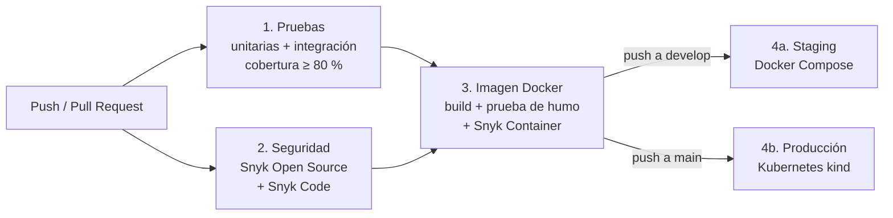

# EcoMarket — API REST de Mercado Ecológico

Backend de un mercado ecológico desarrollado con **Spring Boot**, que expone una API REST para la gestión de productos, usuarios y pedidos. Arquitectura en capas siguiendo buenas prácticas de desarrollo Java.

## Modelo de ramificación: GitFlow

Este proyecto implementa **GitFlow** como estrategia de trabajo colaborativo para mantener trazabilidad, estabilidad y orden en el desarrollo.

### Ramas principales

- `main`: versión estable y lista para producción.
- `develop`: rama de integración para nuevas funcionalidades.
- `feature/<nombre>`: desarrollo de nuevas funcionalidades.
- `hotfix/<nombre>`: correcciones urgentes sobre producción.

### ¿Por qué GitFlow?

GitFlow es adecuado para este proyecto porque:

- separa claramente el código de producción del desarrollo activo;
- facilita la colaboración entre varios integrantes;
- permite trabajar en features en paralelo sin afectar la rama principal;
- ofrece un flujo definido para correcciones urgentes con `hotfix`.

Este enfoque cumple con la evaluación de DevOps, ya que demuestra control de versiones, trazabilidad y un proceso ordenado de integración.

---

## Flujo de trabajo del equipo

1. Crear una rama `feature/<nombre>` desde `develop`.
2. Implementar la funcionalidad con commits pequeños y descriptivos.
3. Abrir un Pull Request hacia `develop`.
4. Revisar el código y dejar evidencia de aprobación.
5. Integrar a `develop` usando merge con trazabilidad.
6. Cuando haya un problema crítico en producción, crear `hotfix/<nombre>` desde `main`.
7. Corregir y fusionar a `main`, luego sincronizar a `develop`.

---

## Convenciones de commits

Se recomienda usar mensajes en estilo convencional:

- `feat:` nuevas funcionalidades
- `fix:` correcciones de errores
- `docs:` cambios en documentación
- `chore:` tareas de mantenimiento
- `refactor:` mejoras internas sin cambiar comportamiento
- `test:` cambios relacionados con pruebas

Ejemplos:

- `feat(productos): agregar endpoints CRUD`
- `fix(usuario): corregir validación de correo`
- `docs(readme): documentar flujo GitFlow`
- `chore(ci): configurar GitHub Actions`

---

## Reglas de revisión y merge

- Todo cambio debe pasar la validación automática.
- Todo Pull Request debe revisarse antes del merge.
- No se fusiona directamente a `main` sin revisión.
- Los conflictos deben resolverse antes de integrar.
- Los mensajes de commit deben ser claros y específicos.

---

## Pipeline CI/CD (GitHub Actions)

El pipeline está en [`.github/workflows/ci-cd.yml`](.github/workflows/ci-cd.yml) y automatiza todo el ciclo de vida del microservicio: pruebas → seguridad → imagen → despliegue. Cada etapa depende de la anterior, así que **si una etapa falla, las siguientes no se ejecutan** y no se publica ni se despliega nada.



### Cuándo se ejecuta cada etapa

| Evento | Pruebas | Seguridad | Imagen | Publica en GHCR | Despliegue |
|--------|:-:|:-:|:-:|:-:|------------|
| Pull request hacia `develop` o `main` | Sí | Sí | Sí | — | — |
| Push (merge) a `develop` | Sí | Sí | Sí | Sí | Staging (Docker Compose) |
| Push (merge) a `main` | Sí | Sí | Sí | Sí | Producción (Kubernetes) |

### Etapas

**1. Pruebas (IE2)** — `./mvnw verify`
- **Pruebas unitarias** (JUnit 5 + Mockito, archivos `*Test.java`): prueban la lógica de los servicios aislada de la base de datos.
- **Pruebas de integración** (`*IT.java`, MockMvc + H2): prueban los endpoints de punta a punta: códigos HTTP, validaciones, que la contraseña no se exponga, etc.
- **Política de calidad**: JaCoCo mide la cobertura y **el build falla si la cobertura de líneas baja del 80 %** (configurable en `pom.xml`, propiedad `jacoco.minimo.lineas`).
- Los reportes de pruebas y cobertura se guardan como *artifact* de cada ejecución y se resumen en la página del run.

**2. Seguridad (IE3)** — Snyk + Dependabot
| Control | Herramienta | Acción si falla |
|---------|-------------|-----------------|
| Vulnerabilidades en dependencias Maven | Snyk Open Source | **Bloquea** con severidad alta o crítica |
| Análisis estático del código fuente | Snyk Code | **Bloquea** con severidad alta |
| Vulnerabilidades en la imagen Docker | Snyk Container | **Bloquea** con severidad crítica |
| Alertas visibles en GitHub | SARIF → *Security › Code scanning* | Alerta en el repositorio |
| Monitoreo continuo | `snyk monitor` | Snyk avisa por correo si aparece una vulnerabilidad nueva |
| Actualización de dependencias | Dependabot ([`.github/dependabot.yml`](.github/dependabot.yml)) | Abre PRs semanales hacia `develop` para Maven, Docker y GitHub Actions |

**3. Imagen Docker (IE1)**
- Se construye con el [`Dockerfile`](Dockerfile), se arranca y se verifica que queda *healthy* y que no corre como root.
- Se ejecuta la [prueba de humo](scripts/smoke-test.sh) contra el contenedor.
- Se escanea con Snyk Container y solo entonces se publica en GitHub Container Registry (`ghcr.io/j4vierlb/ecomarket`).
- Al publicarla se genera su **SBOM** (inventario de componentes en formato SPDX) y dos **atestaciones firmadas** (procedencia y SBOM) que certifican qué commit y qué ejecución del pipeline la produjeron. Se verifican con:
  ```bash
  gh attestation verify oci://ghcr.io/j4vierlb/ecomarket:<etiqueta> --owner j4vierlb
  ```

**4a. Staging — Docker Compose (IE4)**
Levanta MySQL, 2 réplicas de la API y un balanceador nginx con la imagen recién publicada. Ejecuta la prueba de humo y comprueba que las peticiones se reparten entre las réplicas.

**4b. Producción — Kubernetes (IE4, IE5)**
Crea un clúster Kubernetes efímero con [kind](https://kind.sigs.k8s.io/) que simula el entorno cloud y reproduce una actualización real:

1. **Estado inicial**: despliega la versión que ya estaba en producción (imagen con la etiqueta `produccion`).
2. **Rolling update** a la imagen del commit nuevo, sin cortes (`maxUnavailable: 0`).
3. **Verificación**: espera el *rollout* y ejecuta la prueba de humo.
4. **Rollback automático**: si la verificación falla, ejecuta `kubectl rollout undo`, comprueba que la versión anterior responde y marca el despliegue como fallido.
5. **Prueba de carga**: si la versión nueva funciona, genera tráfico durante 3 minutos y registra en el resumen cómo el HPA aumenta las réplicas.
6. Solo entonces la imagen nueva recibe la etiqueta `produccion` y pasa a ser la referencia para un futuro rollback.

**Demostrar el rollback**: en *Actions › EcoMarket CI/CD › Run workflow*, elige la rama `main` y marca **"simular_fallo"**. El pipeline intentará desplegar una versión defectuosa, Kubernetes la mantendrá sin tráfico (las réplicas anteriores siguen atendiendo) y el rollback devolverá producción a la versión estable.

### Trazabilidad

Cada cambio puede seguirse desde el commit hasta el despliegue:

1. **Commit → PR**: GitFlow con PRs obligatorios y commits convencionales.
2. **PR → ejecución del pipeline**: cada PR muestra el resultado de las 3 primeras etapas antes de poder hacer merge.
3. **Ejecución → imagen**: la imagen se etiqueta con `sha-<commit>` y lleva etiquetas OCI (`org.opencontainers.image.revision`, `source`, `created`). El resumen del run registra la imagen y su *digest*.
4. **Imagen → despliegue**: los jobs de despliegue usan los *environments* `staging` y `production` de GitHub, que guardan el historial de qué commit se desplegó y cuándo (pestaña *Deployments*).
5. **Despliegue → Kubernetes**: el Deployment se anota con commit, ejecución y autor (`kubectl rollout history` lo muestra), lo que permite saber qué versión corre y volver atrás con `kubectl rollout undo`.

### Configuración necesaria en GitHub

| Qué | Dónde | Para qué |
|-----|-------|----------|
| Secret `SNYK_TOKEN` | *Settings › Secrets and variables › Actions* | Análisis de Snyk (token en [app.snyk.io](https://app.snyk.io) › *Account settings*) |
| Secret `SNYK_TOKEN` (también) | *Settings › Secrets and variables › Dependabot* | Que los PRs de Dependabot también pasen el análisis |
| Snyk Code activado | app.snyk.io › *Settings › Snyk Code* | Análisis estático del código |
| Dependabot alerts y security updates | *Settings › Advanced Security* | Alertas de dependencias vulnerables |
| Reglas de protección de `main` y `develop` | *Settings › Branches* | Exigir que el pipeline pase antes de hacer merge |

---

## Tecnologías utilizadas

| Capa | Tecnología |
|------|-----------|
| Backend | Java + Spring Boot |
| Persistencia | Spring Data JPA + Hibernate |
| Base de datos | H2 en memoria (por defecto) / MySQL (perfil `mysql`) |
| Validación | Bean Validation (Jakarta) |
| Seguridad | Contraseñas hasheadas con BCrypt |
| API | REST con JSON |
| Build | Maven (wrapper `./mvnw`) |
| Pruebas | JUnit 5, Mockito, MockMvc, JaCoCo |
| Contenedores | Docker (multi-etapa), Docker Compose, nginx |
| Orquestación | Kubernetes (kind), HPA, PodDisruptionBudget, NetworkPolicy |
| CI/CD | GitHub Actions, GitHub Container Registry |
| Seguridad del pipeline | Snyk (Open Source, Code, Container), Dependabot |

---

## Endpoints disponibles

### Productos — `/api/productos`

| Método | Endpoint | Descripción |
|--------|----------|-------------|
| GET | `/api/productos` | Listar todos los productos |
| GET | `/api/productos/{id}` | Obtener producto por ID |
| POST | `/api/productos` | Crear nuevo producto |
| PUT | `/api/productos/{id}` | Actualizar producto |
| DELETE | `/api/productos/{id}` | Eliminar producto |

### Usuarios — `/api/usuarios`

| Método | Endpoint | Descripción |
|--------|----------|-------------|
| GET | `/api/usuarios` | Listar todos los usuarios |
| GET | `/api/usuarios/{id}` | Obtener usuario por ID |
| POST | `/api/usuarios` | Crear nuevo usuario |
| PUT | `/api/usuarios/{id}` | Actualizar usuario |
| DELETE | `/api/usuarios/{id}` | Eliminar usuario |

### Pedidos — `/api/pedidos`

| Método | Endpoint | Descripción |
|--------|----------|-------------|
| GET | `/api/pedidos` | Listar todos los pedidos |
| GET | `/api/pedidos/{id}` | Obtener pedido por ID |
| POST | `/api/pedidos` | Crear nuevo pedido |
| PUT | `/api/pedidos/{id}` | Actualizar pedido |
| DELETE | `/api/pedidos/{id}` | Eliminar pedido |

### Códigos de respuesta

| Código | Cuándo |
|--------|--------|
| `200` | Consulta o actualización correcta |
| `201` | Recurso creado (POST) |
| `204` | Recurso eliminado (DELETE) |
| `400` | Datos inválidos; el cuerpo incluye `errores` por campo |
| `404` | El recurso con ese `id` no existe |
| `409` | Ya existe un usuario con ese correo |

### Validaciones

- **Usuario**: `nombre` obligatorio (máx. 100), `correo` obligatorio, con formato válido y único, `contrasena` obligatoria (mín. 8 caracteres). La contraseña se guarda hasheada con BCrypt y nunca se devuelve en las respuestas.
- **Producto**: `nombre` obligatorio, `stock` ≥ 0, `precio` obligatorio y > 0.
- **Pedido**: `descripcion` obligatoria, `total` obligatorio y ≥ 0. Si no se envía `fecha`, se usa la fecha actual.

---

## Arquitectura

El código sigue una arquitectura en 3 capas:

```
Controller (REST)  →  Service (lógica de negocio)  →  Repository (acceso a datos)
```

```
.
├── .github/
│   ├── workflows/ci-cd.yml   # Pipeline CI/CD
│   └── dependabot.yml        # Actualización automática de dependencias
├── Dockerfile                # Imagen multi-etapa de la API
├── docker-compose.yml        # Staging: API x2 + MySQL + nginx
├── docker/nginx/nginx.conf   # Balanceador de carga
├── k8s/                      # Manifiestos de Kubernetes (producción)
├── scripts/smoke-test.sh     # Prueba de humo post-despliegue
└── src/
    ├── main/java/com/grupo3/EcoMarket/
    │   ├── config/           # CORS y PasswordEncoder
    │   ├── exception/        # Manejo global de errores
    │   ├── controller/       # Controladores REST
    │   ├── service/          # Lógica de negocio
    │   ├── repository/       # Acceso a datos (Spring Data JPA)
    │   └── model/            # Entidades JPA
    └── test/java/com/grupo3/EcoMarket/
        ├── service/          # Pruebas unitarias (*Test)
        └── controller/       # Pruebas de integración (*IT)
```

---

## Contenedores y orquestación

### Imagen Docker (IE1)

El [`Dockerfile`](Dockerfile) usa **dos etapas**: una con el JDK para compilar y otra solo con el JRE para ejecutar, de modo que la imagen final no lleva Maven, el código fuente ni el JDK.

- **Capas de Spring Boot**: las dependencias van en una capa separada del código de la aplicación, así un cambio en el código no obliga a volver a descargar las dependencias.
- **Usuario sin privilegios** (UID 10001) y archivos de la aplicación de solo lectura para ese usuario.
- **`HEALTHCHECK`** con el endpoint de Actuator `/actuator/health/liveness`.
- **Memoria de la JVM ajustada al contenedor** (`-XX:MaxRAMPercentage=75`).
- **JRE a medida con `jlink`**: en vez del JRE completo, la imagen incluye solo los módulos de Java que usa la aplicación (calculados con `jdeps`), sobre una base `ubuntu:noble` mínima y multiplataforma. Esto reduce el tamaño y la cantidad de software que puede tener vulnerabilidades. El *healthcheck* usa `bash` en vez de `curl` o `wget`, que no se instalan.

### Docker Compose — staging (IE5)

[`docker-compose.yml`](docker-compose.yml) levanta:

| Servicio | Detalle |
|----------|---------|
| `db` | MySQL 8.4 con volumen persistente, *healthcheck* y **sin puerto expuesto** al exterior |
| `app` | 2 réplicas de la API (`APP_REPLICAS`), sistema de archivos de solo lectura, límites de CPU/memoria, `no-new-privileges` |
| `proxy` | nginx que **reparte la carga entre las réplicas** y es el único servicio expuesto (puerto 8081) |

La API solo arranca cuando MySQL está *healthy*, y nginx solo cuando la API lo está. La base de datos está en una red interna (`backend`) a la que nginx no tiene acceso.

### Kubernetes — producción (IE3, IE5)

Los manifiestos de [`k8s/`](k8s/) se aplican con Kustomize:

| Recurso | Para qué |
|---------|----------|
| `Deployment` (2 réplicas) | *Rolling update* sin cortes (`maxUnavailable: 0`), *probes* de arranque, vida y disponibilidad, `requests`/`limits` de CPU y memoria |
| `HorizontalPodAutoscaler` | **Escala de 2 a 5 réplicas** cuando la CPU media supera el 70 % |
| `PodDisruptionBudget` | Siempre queda al menos 1 réplica disponible durante mantenimientos |
| `StatefulSet` MySQL | Base de datos con volumen persistente propio |
| `NetworkPolicy` | **Solo los pods de la API pueden conectarse a MySQL** |
| `Namespace` con *Pod Security Standards* `restricted` | Rechaza contenedores como root, con privilegios o sin perfil seccomp |
| `Secret` | Credenciales generadas por el pipeline, nunca guardadas en el repositorio |

---

## Instalación y ejecución

### Requisitos previos

- Java 17+ (para ejecutar sin Docker)
- Docker (para Compose)
- Opcional: [kind](https://kind.sigs.k8s.io/) y `kubectl` para Kubernetes

No hace falta instalar Maven: el proyecto incluye el wrapper `./mvnw`.

### Opción 1: local con H2 en memoria

```bash
git clone https://github.com/j4vierlb/EcoMarket_DEVOPS.git
cd EcoMarket_DEVOPS
./mvnw spring-boot:run
```

La API queda en `http://localhost:8080` (los datos se pierden al reiniciar).

### Opción 2: Docker Compose (MySQL + 2 réplicas + nginx)

```bash
cp .env.example .env          # y cambia las contraseñas
docker compose up -d --build --wait
scripts/smoke-test.sh http://localhost:8081
docker compose down           # agrega -v para borrar también los datos
```

La API queda en `http://localhost:8081`.

### Opción 3: Kubernetes local con kind

```bash
kind create cluster --name ecomarket
docker build -t ecomarket:local .
kind load docker-image ecomarket:local --name ecomarket
kubectl apply -f k8s/namespace.yaml
kubectl -n ecomarket create secret generic ecomarket-db \
  --from-literal=DB_USER=ecomarket \
  --from-literal=DB_PASSWORD=<clave> \
  --from-literal=DB_ROOT_PASSWORD=<clave-root>
kubectl apply -k k8s
kubectl -n ecomarket rollout status deployment/ecomarket
kubectl -n ecomarket port-forward svc/ecomarket 8080:80
```

### Ejecutar las pruebas

```bash
./mvnw verify   # unitarias + integración + control de cobertura
```

El reporte de cobertura queda en `target/site/jacoco/index.html`.

---

## Ejemplo de uso

### Crear un producto

```bash
POST /api/productos
Content-Type: application/json

{
  "nombre": "Manzanas orgánicas",
  "descripcion": "Manzanas cultivadas sin pesticidas",
  "stock": 100,
  "precio": 1500
}
```

### Crear un usuario

```bash
POST /api/usuarios
Content-Type: application/json

{
  "nombre": "Juan Pérez",
  "correo": "juan@email.com",
  "contrasena": "segura123"
}
```

---

## Evidencias

Ejecuciones reales del pipeline que demuestran cada parte del encargo. En cada enlace, la sección **Summary** muestra el resumen de pruebas, seguridad, imagen y despliegue.

| Qué demuestra | Indicador | Evidencia |
|---------------|-----------|-----------|
| Snyk **bloqueó** el pipeline por 30 vulnerabilidades (23 altas, 7 críticas) de Spring Boot 3.5 | IE3 | [Ejecución bloqueada](https://github.com/j4vierlb/EcoMarket_DEVOPS/actions/runs/39893755541/attempts/2) |
| Tras actualizar a Spring Boot 4.1.2 quedaron 2; se corrigieron fijando Jackson 3.1.8 y excluyendo JAXB | IE3 | [Ejecución con 2 restantes](https://github.com/j4vierlb/EcoMarket_DEVOPS/actions/runs/41164334069) · [PR #2](https://github.com/j4vierlb/EcoMarket_DEVOPS/pull/2) |
| Despliegue automático en **staging** (Docker Compose: MySQL + 2 réplicas + nginx) | IE4, IE5 | [Ejecución en develop](https://github.com/j4vierlb/EcoMarket_DEVOPS/actions/runs/41214788696) |
| Despliegue automático en **producción** (Kubernetes) con **autoescalado bajo carga** | IE4, IE5 | [Ejecución en main](https://github.com/j4vierlb/EcoMarket_DEVOPS/actions/runs/41215808186) |
| **Rollback automático** ante una versión defectuosa (fallo simulado) | IE4 | [Ejecución con rollback](https://github.com/j4vierlb/EcoMarket_DEVOPS/actions/runs/41219235225) |
| Dependabot abre PRs de actualización y pasan por el pipeline completo | IE3 | [PRs de Dependabot](https://github.com/j4vierlb/EcoMarket_DEVOPS/pulls?q=is%3Apr+author%3Aapp%2Fdependabot) |
| Alertas de seguridad publicadas en GitHub (SARIF de Snyk) | IE3 | Pestaña *Security › Code scanning*, visible para los administradores del repositorio; los checks *Snyk Open Source*, *SnykCode* y *Snyk Container* aparecen en cada PR |
| Atestaciones firmadas (procedencia SLSA y SBOM) de cada imagen publicada | IE1, IE4 | [Atestaciones](https://github.com/j4vierlb/EcoMarket_DEVOPS/attestations) |
| Imágenes publicadas y etiquetadas por commit | IE1, IE4 | [Paquete ecomarket](https://github.com/j4vierlb/EcoMarket_DEVOPS/pkgs/container/ecomarket) |

### Autoescalado durante la prueba de carga

Registro de la [ejecución en producción](https://github.com/j4vierlb/EcoMarket_DEVOPS/actions/runs/41215808186): con la carga, la CPU media supera el objetivo del 70 % y el HPA pasa de 2 a 3 réplicas a los 40 s y a 5 (el máximo) a los 60 s.

| Segundo | CPU media / objetivo | Réplicas |
|--------:|---------------------:|---------:|
| 0 | — / 70 % | 2 |
| 20 | 79 % / 70 % | 2 |
| 40 | 187 % / 70 % | 3 |
| 60 | 395 % / 70 % | 5 |
| 120 | 289 % / 70 % | 5 |
| 180 | 277 % / 70 % | 5 |

### Rollback automático

Registro de la [ejecución con fallo simulado](https://github.com/j4vierlb/EcoMarket_DEVOPS/actions/runs/41219235225):

1. Producción parte con la versión estable (`9c155b8`, etiqueta `produccion`).
2. Se despliega una imagen inexistente (`version-defectuosa`): el pod nuevo queda en `ImagePullBackOff` y, gracias a `maxUnavailable: 0`, las 2 réplicas estables siguen atendiendo.
3. La verificación detecta que el *rollout* no termina (`timed out waiting for the condition`).
4. El pipeline ejecuta `kubectl rollout undo`, la versión `9c155b8` vuelve a estar activa y la prueba de humo pasa completa.
5. El despliegue se marca como fallido (en rojo), porque la versión nueva no llegó a producción.

### Tamaño de la imagen

| Versión | Tamaño |
|---------|-------:|
| JRE completo (`eclipse-temurin:17-jre-noble`) | 523 MB |
| JRE a medida con `jlink` sobre `ubuntu:noble` | 346 MB (−34 %) |

---

## Autor

**Javier Lara Bustos**  
[GitHub](https://github.com/j4vierlb)

## Justificación técnica

- **Dockerfile multi-etapa:** la imagen final no lleva JDK, Maven ni código fuente, así pesa menos y tiene menos riesgos. Corre sin privilegios para limitar el daño si la comprometen.
- **JRE a medida con jlink:** jlink arma un JRE con solo los módulos de Java que usa la app, en vez de llevar el JRE completo. La imagen bajó de 523 MB a 346 MB, y con menos software instalado hay menos posibles vulnerabilidades. Va sobre ubuntu:noble, que funciona en Intel y ARM.
- **Pruebas unitarias e integración:** cada tipo detecta errores distintos, así que con una sola quedaría un hueco.
- **Cobertura del 80%:** obliga a probar lo importante sin gastar esfuerzo en llegar al 100%, y si no se cumple el build falla.
- **Snyk:** una herramienta cubre dependencias, código e imagen. Bloqueamos desde severidad alta en lo que podemos corregir, y solo con críticas en la imagen, porque la base suele traer fallas altas sin parche.
- **Etiqueta por commit:** cualquier versión desplegada se rastrea hasta su código exacto, y solo se publica la imagen que ya pasó las pruebas.
- **Compose y Kubernetes:** Compose es simple para validar en staging, y Kubernetes da autoescalado, actualizaciones sin cortes, reinicio automático y aislamiento de red en producción.
- **2 réplicas y 512 MB:** con 2 réplicas el servicio sigue si una falla, y el límite sale del consumo medido de unos 210 MB.
- **Prueba de carga:** demuestra con datos que el autoescalado funciona, en lugar de suponer que escala al pasar el 70% de CPU.
- **Rollback automático:** si un despliegue falla, vuelve solo a la versión anterior sin depender de alguien que lo note. Esa versión se identifica con la etiqueta produccion, que solo recibe una imagen después de pasar la verificación, y las etiquetas por commit indican qué código tiene cada una.

## Declaración de uso de Inteligencia Artificial

| Herramienta | Uso |
|-------------|-----|
| Claude Code (Anthropic) | Generación de la implementación técnica (Dockerfile, Compose, Kubernetes, pipeline, pruebas) y corrección del microservicio, revisadas y validadas por el estudiante. |
| Claude Code (Anthropic) | Explicación de conceptos y decisiones técnicas como apoyo al aprendizaje. |

La elección de herramientas, la configuración de Snyk y GitHub, los merges, la validación de los despliegues y la redacción de la justificación, las conclusiones y la reflexión fueron realizadas por el estudiante sin IA. Referencia: [Biblioteca Duoc UC — Uso de IA](https://bibliotecas.duoc.cl/ia).

## Conclusiones

Logramos que todo el ciclo del microservicio corra solo. Cada cambio se prueba, se revisa en seguridad, se empaqueta y sale a staging y luego a producción sin que nadie lo haga a mano.

### Lo que el pipeline nos frenó
Lo mejor fue ver que paraba problemas de verdad. Snyk encontró 30 vulnerabilidades (23 altas y 7 críticas) porque Spring Boot 3.5 ya no tenía parches, así que migramos a 4.1.2, fijamos Jackson 3.1.8 y sacamos JAXB, que tenía una falla sin solución publicada. También arreglamos el Maven Wrapper incompleto, la API que partía antes que MySQL (con un initContainer) y nginx, que no repartía la carga hasta configurar la resolución DNS dinámica.

### Mejoras futuras
Más adelante nos gustaría hacer una prueba de carga que muestre el autoescalado, agregar rollback automático si un despliegue falla, usar Flyway para las migraciones, sumar autenticación a la API y probar todo en un cloud real.

### Reflexión individual — Javier Lara Bustos
Me quedó claro que un pipeline es mucho más que correr pruebas: es una serie de filtros para que nada roto llegue a producción. Lo más difícil fue Kubernetes, entender pods, probes y HPA, y al principio no sabía por qué Snyk lo bloqueaba todo, hasta que vi que eran fallas reales. Yo configuré Snyk y los secrets, revisé y mergeé los cambios y probé los despliegues. Lo hice apoyándome en una IA, pero revisando y entendiendo cada paso.
