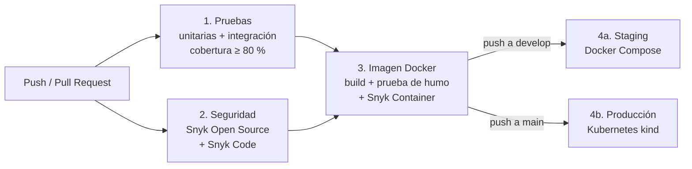

# 🌿 EcoMarket — API REST de Mercado Ecológico

Backend de un mercado ecológico desarrollado con **Spring Boot**, que expone una API REST para la gestión de productos, usuarios y pedidos. Arquitectura en capas siguiendo buenas prácticas de desarrollo Java.

## 🧭 Modelo de ramificación: GitFlow

Este proyecto implementa **GitFlow** como estrategia de trabajo colaborativo para mantener trazabilidad, estabilidad y orden en el desarrollo.

### Ramas principales

- `main`: versión estable y lista para producción.
- `develop`: rama de integración para nuevas funcionalidades.
- `feature/<nombre>`: desarrollo de nuevas funcionalidades.
- `hotfix/<nombre>`: correcciones urgentes sobre producción.

### ¿Por qué GitFlow?

GitFlow es adecuado para este proyecto porque:

- separa claramente el código de producción del desarrollo activo;
- facilita la colaboración entre varios integrantes;
- permite trabajar en features en paralelo sin afectar la rama principal;
- ofrece un flujo definido para correcciones urgentes con `hotfix`.

Este enfoque cumple con la evaluación de DevOps, ya que demuestra control de versiones, trazabilidad y un proceso ordenado de integración.

---

## 🔀 Flujo de trabajo del equipo

1. Crear una rama `feature/<nombre>` desde `develop`.
2. Implementar la funcionalidad con commits pequeños y descriptivos.
3. Abrir un Pull Request hacia `develop`.
4. Revisar el código y dejar evidencia de aprobación.
5. Integrar a `develop` usando merge con trazabilidad.
6. Cuando haya un problema crítico en producción, crear `hotfix/<nombre>` desde `main`.
7. Corregir y fusionar a `main`, luego sincronizar a `develop`.

---

## 📝 Convenciones de commits

Se recomienda usar mensajes en estilo convencional:

- `feat:` nuevas funcionalidades
- `fix:` correcciones de errores
- `docs:` cambios en documentación
- `chore:` tareas de mantenimiento
- `refactor:` mejoras internas sin cambiar comportamiento
- `test:` cambios relacionados con pruebas

Ejemplos:

- `feat(productos): agregar endpoints CRUD`
- `fix(usuario): corregir validación de correo`
- `docs(readme): documentar flujo GitFlow`
- `chore(ci): configurar GitHub Actions`

---

## ✅ Reglas de revisión y merge

- Todo cambio debe pasar la validación automática.
- Todo Pull Request debe revisarse antes del merge.
- No se fusiona directamente a `main` sin revisión.
- Los conflictos deben resolverse antes de integrar.
- Los mensajes de commit deben ser claros y específicos.

---

## 🚀 Pipeline CI/CD (GitHub Actions)

El pipeline está en [`.github/workflows/ci-cd.yml`](.github/workflows/ci-cd.yml) y automatiza todo el ciclo de vida del microservicio: pruebas → seguridad → imagen → despliegue. Cada etapa depende de la anterior, así que **si una etapa falla, las siguientes no se ejecutan** y no se publica ni se despliega nada.



### Cuándo se ejecuta cada etapa

| Evento | Pruebas | Seguridad | Imagen | Publica en GHCR | Despliegue |
|--------|:-:|:-:|:-:|:-:|------------|
| Pull request hacia `develop` o `main` | ✅ | ✅ | ✅ | — | — |
| Push (merge) a `develop` | ✅ | ✅ | ✅ | ✅ | Staging (Docker Compose) |
| Push (merge) a `main` | ✅ | ✅ | ✅ | ✅ | Producción (Kubernetes) |

### Etapas

**1. Pruebas (IE2)** — `./mvnw verify`
- **Pruebas unitarias** (JUnit 5 + Mockito, archivos `*Test.java`): prueban la lógica de los servicios aislada de la base de datos.
- **Pruebas de integración** (`*IT.java`, MockMvc + H2): prueban los endpoints de punta a punta: códigos HTTP, validaciones, que la contraseña no se exponga, etc.
- **Política de calidad**: JaCoCo mide la cobertura y **el build falla si la cobertura de líneas baja del 80 %** (configurable en `pom.xml`, propiedad `jacoco.minimo.lineas`).
- Los reportes de pruebas y cobertura se guardan como *artifact* de cada ejecución y se resumen en la página del run.

**2. Seguridad (IE3)** — Snyk + Dependabot
| Control | Herramienta | Acción si falla |
|---------|-------------|-----------------|
| Vulnerabilidades en dependencias Maven | Snyk Open Source | **Bloquea** con severidad alta o crítica |
| Análisis estático del código fuente | Snyk Code | **Bloquea** con severidad alta |
| Vulnerabilidades en la imagen Docker | Snyk Container | **Bloquea** con severidad crítica |
| Alertas visibles en GitHub | SARIF → *Security › Code scanning* | Alerta en el repositorio |
| Monitoreo continuo | `snyk monitor` | Snyk avisa por correo si aparece una vulnerabilidad nueva |
| Actualización de dependencias | Dependabot ([`.github/dependabot.yml`](.github/dependabot.yml)) | Abre PRs semanales hacia `develop` para Maven, Docker y GitHub Actions |

**3. Imagen Docker (IE1)**
- Se construye con el [`Dockerfile`](Dockerfile), se arranca y se verifica que queda *healthy* y que no corre como root.
- Se ejecuta la [prueba de humo](scripts/smoke-test.sh) contra el contenedor.
- Se escanea con Snyk Container y solo entonces se publica en GitHub Container Registry (`ghcr.io/j4vierlb/ecomarket`).

**4a. Staging — Docker Compose (IE4)**
Levanta MySQL, 2 réplicas de la API y un balanceador nginx con la imagen recién publicada. Ejecuta la prueba de humo y comprueba que las peticiones se reparten entre las réplicas.

**4b. Producción — Kubernetes (IE4, IE5)**
Crea un clúster Kubernetes efímero con [kind](https://kind.sigs.k8s.io/) que simula el entorno cloud, despliega los manifiestos de [`k8s/`](k8s/) con la imagen del commit, espera el *rollout* y ejecuta la prueba de humo.

### 🔎 Trazabilidad

Cada cambio puede seguirse desde el commit hasta el despliegue:

1. **Commit → PR**: GitFlow con PRs obligatorios y commits convencionales.
2. **PR → ejecución del pipeline**: cada PR muestra el resultado de las 3 primeras etapas antes de poder hacer merge.
3. **Ejecución → imagen**: la imagen se etiqueta con `sha-<commit>` y lleva etiquetas OCI (`org.opencontainers.image.revision`, `source`, `created`). El resumen del run registra la imagen y su *digest*.
4. **Imagen → despliegue**: los jobs de despliegue usan los *environments* `staging` y `production` de GitHub, que guardan el historial de qué commit se desplegó y cuándo (pestaña *Deployments*).
5. **Despliegue → Kubernetes**: el Deployment se anota con commit, ejecución y autor (`kubectl rollout history` lo muestra), lo que permite saber qué versión corre y volver atrás con `kubectl rollout undo`.

### ⚙️ Configuración necesaria en GitHub

| Qué | Dónde | Para qué |
|-----|-------|----------|
| Secret `SNYK_TOKEN` | *Settings › Secrets and variables › Actions* | Análisis de Snyk (token en [app.snyk.io](https://app.snyk.io) › *Account settings*) |
| Secret `SNYK_TOKEN` (también) | *Settings › Secrets and variables › Dependabot* | Que los PRs de Dependabot también pasen el análisis |
| Snyk Code activado | app.snyk.io › *Settings › Snyk Code* | Análisis estático del código |
| Dependabot alerts y security updates | *Settings › Advanced Security* | Alertas de dependencias vulnerables |
| Reglas de protección de `main` y `develop` | *Settings › Branches* | Exigir que el pipeline pase antes de hacer merge |

---

## 🚀 Tecnologías utilizadas

| Capa | Tecnología |
|------|-----------|
| Backend | Java + Spring Boot |
| Persistencia | Spring Data JPA + Hibernate |
| Base de datos | H2 en memoria (por defecto) / MySQL (perfil `mysql`) |
| Validación | Bean Validation (Jakarta) |
| Seguridad | Contraseñas hasheadas con BCrypt |
| API | REST con JSON |
| Build | Maven (wrapper `./mvnw`) |
| Pruebas | JUnit 5, Mockito, MockMvc, JaCoCo |
| Contenedores | Docker (multi-etapa), Docker Compose, nginx |
| Orquestación | Kubernetes (kind), HPA, PodDisruptionBudget, NetworkPolicy |
| CI/CD | GitHub Actions, GitHub Container Registry |
| Seguridad del pipeline | Snyk (Open Source, Code, Container), Dependabot |

---

## ✨ Endpoints disponibles

### 📦 Productos — `/api/productos`

| Método | Endpoint | Descripción |
|--------|----------|-------------|
| GET | `/api/productos` | Listar todos los productos |
| GET | `/api/productos/{id}` | Obtener producto por ID |
| POST | `/api/productos` | Crear nuevo producto |
| PUT | `/api/productos/{id}` | Actualizar producto |
| DELETE | `/api/productos/{id}` | Eliminar producto |

### 👤 Usuarios — `/api/usuarios`

| Método | Endpoint | Descripción |
|--------|----------|-------------|
| GET | `/api/usuarios` | Listar todos los usuarios |
| GET | `/api/usuarios/{id}` | Obtener usuario por ID |
| POST | `/api/usuarios` | Crear nuevo usuario |
| PUT | `/api/usuarios/{id}` | Actualizar usuario |
| DELETE | `/api/usuarios/{id}` | Eliminar usuario |

### 🛒 Pedidos — `/api/pedidos`

| Método | Endpoint | Descripción |
|--------|----------|-------------|
| GET | `/api/pedidos` | Listar todos los pedidos |
| GET | `/api/pedidos/{id}` | Obtener pedido por ID |
| POST | `/api/pedidos` | Crear nuevo pedido |
| PUT | `/api/pedidos/{id}` | Actualizar pedido |
| DELETE | `/api/pedidos/{id}` | Eliminar pedido |

### Códigos de respuesta

| Código | Cuándo |
|--------|--------|
| `200` | Consulta o actualización correcta |
| `201` | Recurso creado (POST) |
| `204` | Recurso eliminado (DELETE) |
| `400` | Datos inválidos; el cuerpo incluye `errores` por campo |
| `404` | El recurso con ese `id` no existe |
| `409` | Ya existe un usuario con ese correo |

### Validaciones

- **Usuario**: `nombre` obligatorio (máx. 100), `correo` obligatorio, con formato válido y único, `contrasena` obligatoria (mín. 8 caracteres). La contraseña se guarda hasheada con BCrypt y nunca se devuelve en las respuestas.
- **Producto**: `nombre` obligatorio, `stock` ≥ 0, `precio` obligatorio y > 0.
- **Pedido**: `descripcion` obligatoria, `total` obligatorio y ≥ 0. Si no se envía `fecha`, se usa la fecha actual.

---

## 🏗️ Arquitectura

El código sigue una arquitectura en 3 capas:

```
Controller (REST)  →  Service (lógica de negocio)  →  Repository (acceso a datos)
```

```
.
├── .github/
│   ├── workflows/ci-cd.yml   # Pipeline CI/CD
│   └── dependabot.yml        # Actualización automática de dependencias
├── Dockerfile                # Imagen multi-etapa de la API
├── docker-compose.yml        # Staging: API x2 + MySQL + nginx
├── docker/nginx/nginx.conf   # Balanceador de carga
├── k8s/                      # Manifiestos de Kubernetes (producción)
├── scripts/smoke-test.sh     # Prueba de humo post-despliegue
└── src/
    ├── main/java/com/grupo3/EcoMarket/
    │   ├── config/           # CORS y PasswordEncoder
    │   ├── exception/        # Manejo global de errores
    │   ├── controller/       # Controladores REST
    │   ├── service/          # Lógica de negocio
    │   ├── repository/       # Acceso a datos (Spring Data JPA)
    │   └── model/            # Entidades JPA
    └── test/java/com/grupo3/EcoMarket/
        ├── service/          # Pruebas unitarias (*Test)
        └── controller/       # Pruebas de integración (*IT)
```

---

## 🐳 Contenedores y orquestación

### Imagen Docker (IE1)

El [`Dockerfile`](Dockerfile) usa **dos etapas**: una con el JDK para compilar y otra solo con el JRE para ejecutar, de modo que la imagen final no lleva Maven, el código fuente ni el JDK.

- **Capas de Spring Boot**: las dependencias van en una capa separada del código de la aplicación, así un cambio en el código no obliga a volver a descargar las dependencias.
- **Usuario sin privilegios** (UID 10001) y archivos de la aplicación de solo lectura para ese usuario.
- **`HEALTHCHECK`** con el endpoint de Actuator `/actuator/health/liveness`.
- **Memoria de la JVM ajustada al contenedor** (`-XX:MaxRAMPercentage=75`).
- Imagen base `eclipse-temurin:17-jre-noble`, multiplataforma (funciona en Intel/AMD y en Apple Silicon).

### Docker Compose — staging (IE5)

[`docker-compose.yml`](docker-compose.yml) levanta:

| Servicio | Detalle |
|----------|---------|
| `db` | MySQL 8.4 con volumen persistente, *healthcheck* y **sin puerto expuesto** al exterior |
| `app` | 2 réplicas de la API (`APP_REPLICAS`), sistema de archivos de solo lectura, límites de CPU/memoria, `no-new-privileges` |
| `proxy` | nginx que **reparte la carga entre las réplicas** y es el único servicio expuesto (puerto 8081) |

La API solo arranca cuando MySQL está *healthy*, y nginx solo cuando la API lo está. La base de datos está en una red interna (`backend`) a la que nginx no tiene acceso.

### Kubernetes — producción (IE3, IE5)

Los manifiestos de [`k8s/`](k8s/) se aplican con Kustomize:

| Recurso | Para qué |
|---------|----------|
| `Deployment` (2 réplicas) | *Rolling update* sin cortes (`maxUnavailable: 0`), *probes* de arranque, vida y disponibilidad, `requests`/`limits` de CPU y memoria |
| `HorizontalPodAutoscaler` | **Escala de 2 a 5 réplicas** cuando la CPU media supera el 70 % |
| `PodDisruptionBudget` | Siempre queda al menos 1 réplica disponible durante mantenimientos |
| `StatefulSet` MySQL | Base de datos con volumen persistente propio |
| `NetworkPolicy` | **Solo los pods de la API pueden conectarse a MySQL** |
| `Namespace` con *Pod Security Standards* `restricted` | Rechaza contenedores como root, con privilegios o sin perfil seccomp |
| `Secret` | Credenciales generadas por el pipeline, nunca guardadas en el repositorio |

---

## ⚙️ Instalación y ejecución

### Requisitos previos

- Java 17+ (para ejecutar sin Docker)
- Docker (para Compose)
- Opcional: [kind](https://kind.sigs.k8s.io/) y `kubectl` para Kubernetes

No hace falta instalar Maven: el proyecto incluye el wrapper `./mvnw`.

### Opción 1: local con H2 en memoria

```bash
git clone https://github.com/j4vierlb/EcoMarket_DEVOPS.git
cd EcoMarket_DEVOPS
./mvnw spring-boot:run
```

La API queda en `http://localhost:8080` (los datos se pierden al reiniciar).

### Opción 2: Docker Compose (MySQL + 2 réplicas + nginx)

```bash
cp .env.example .env          # y cambia las contraseñas
docker compose up -d --build --wait
scripts/smoke-test.sh http://localhost:8081
docker compose down           # agrega -v para borrar también los datos
```

La API queda en `http://localhost:8081`.

### Opción 3: Kubernetes local con kind

```bash
kind create cluster --name ecomarket
docker build -t ecomarket:local .
kind load docker-image ecomarket:local --name ecomarket
kubectl apply -f k8s/namespace.yaml
kubectl -n ecomarket create secret generic ecomarket-db \
  --from-literal=DB_USER=ecomarket \
  --from-literal=DB_PASSWORD=<clave> \
  --from-literal=DB_ROOT_PASSWORD=<clave-root>
kubectl apply -k k8s
kubectl -n ecomarket rollout status deployment/ecomarket
kubectl -n ecomarket port-forward svc/ecomarket 8080:80
```

### Ejecutar las pruebas

```bash
./mvnw verify   # unitarias + integración + control de cobertura
```

El reporte de cobertura queda en `target/site/jacoco/index.html`.

---

## 📝 Ejemplo de uso

### Crear un producto

```bash
POST /api/productos
Content-Type: application/json

{
  "nombre": "Manzanas orgánicas",
  "descripcion": "Manzanas cultivadas sin pesticidas",
  "stock": 100,
  "precio": 1500
}
```

### Crear un usuario

```bash
POST /api/usuarios
Content-Type: application/json

{
  "nombre": "Juan Pérez",
  "correo": "juan@email.com",
  "contrasena": "segura123"
}
```

---

## 👨‍💻 Autor

**Javier Lara Bustos**  
[GitHub](https://github.com/j4vierlb)

## 🔧 Hotfix: ajuste de pipeline

Se corrige la rama de hotfix para mantener la automatización y la sincronización entre main y develop.

---

## 🧠 Justificación técnica

> ✍️ **Sección para completar por el equipo** (sin IA, según las indicaciones de la evaluación): por qué eligieron estas herramientas y configuraciones (Snyk, umbrales de severidad, cobertura del 80 %, Compose para staging y Kubernetes para producción, número de réplicas, límites de recursos, etc.).

## 🤖 Declaración de uso de Inteligencia Artificial

> ✍️ **Revisar y completar por el equipo.** Borrador con los usos reales registrados:

| Herramienta | Uso |
|-------------|-----|
| Claude Code (Anthropic) | Revisión del código del microservicio y corrección de errores (validaciones, manejo de contraseñas, códigos HTTP). |
| Claude Code (Anthropic) | Apoyo en la escritura del Dockerfile, Docker Compose, manifiestos de Kubernetes, pipeline de GitHub Actions, configuración de Dependabot, pruebas automatizadas y documentación técnica de este README. |

Todo el contenido generado fue revisado, probado y validado por el equipo. Referencia: [Biblioteca Duoc UC — Uso de IA](https://bibliotecas.duoc.cl/ia).

## 📌 Conclusiones

> ✍️ **Sección para completar por el equipo, sin uso de IA.**

### Reflexión individual — Integrante 1

> ✍️ Aprendizaje y contribución al proyecto (sin uso de IA).

### Reflexión individual — Integrante 2

> ✍️ Aprendizaje y contribución al proyecto (sin uso de IA).
